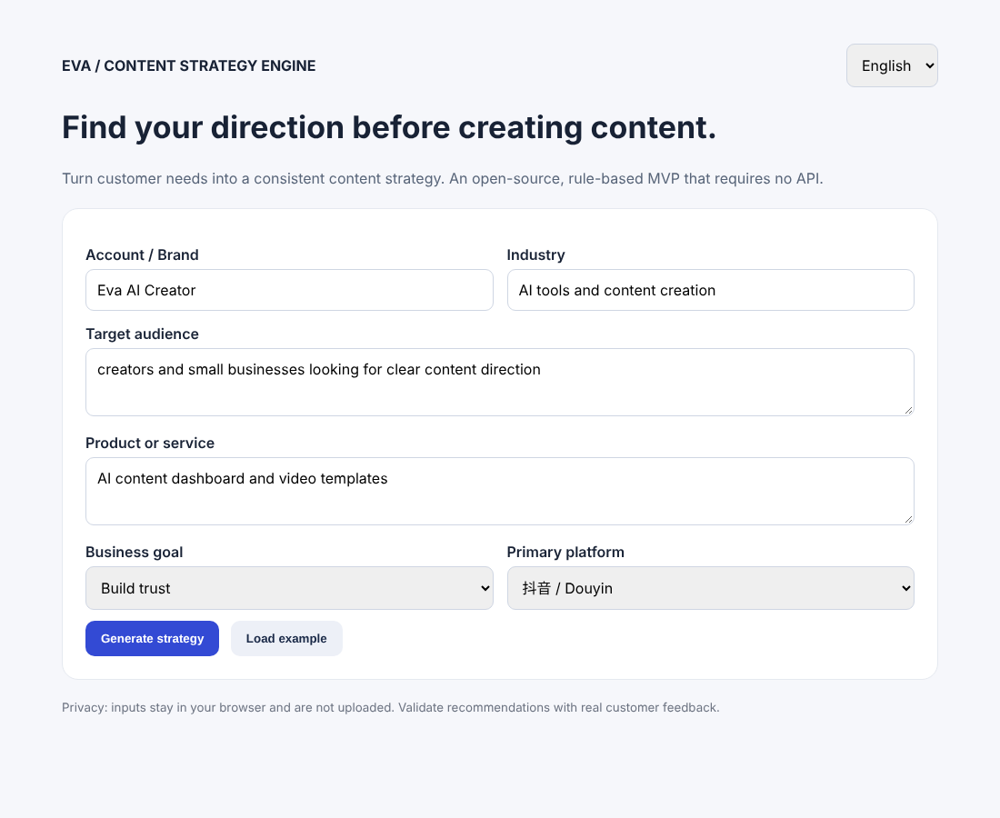
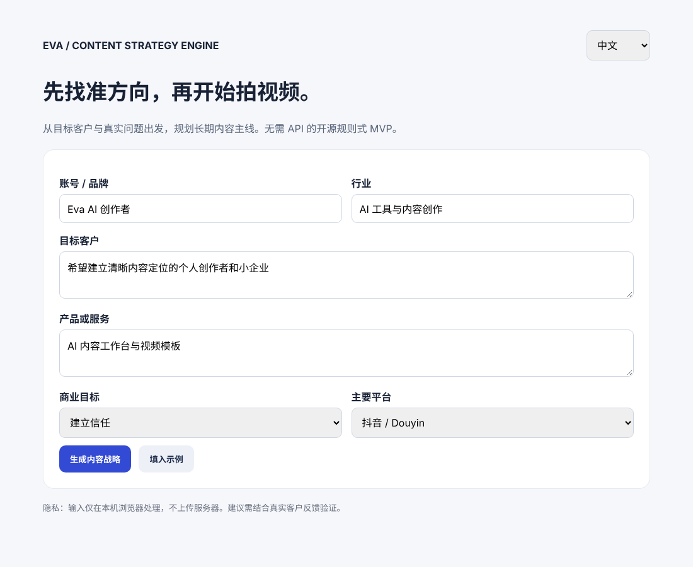
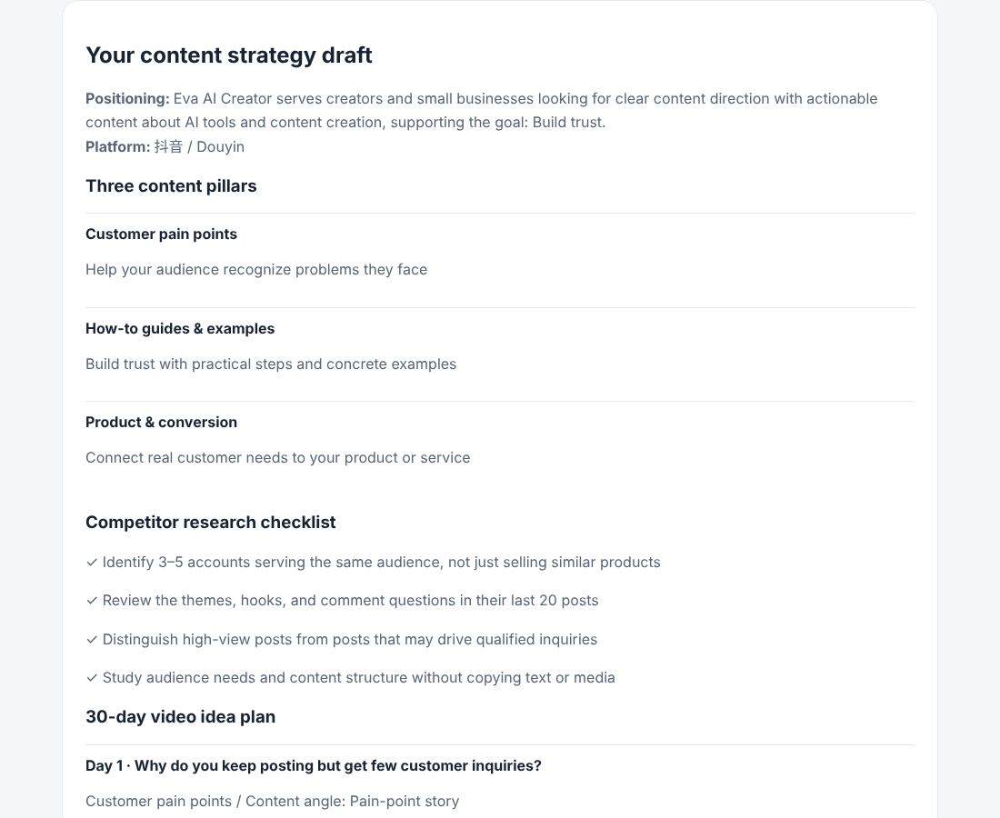
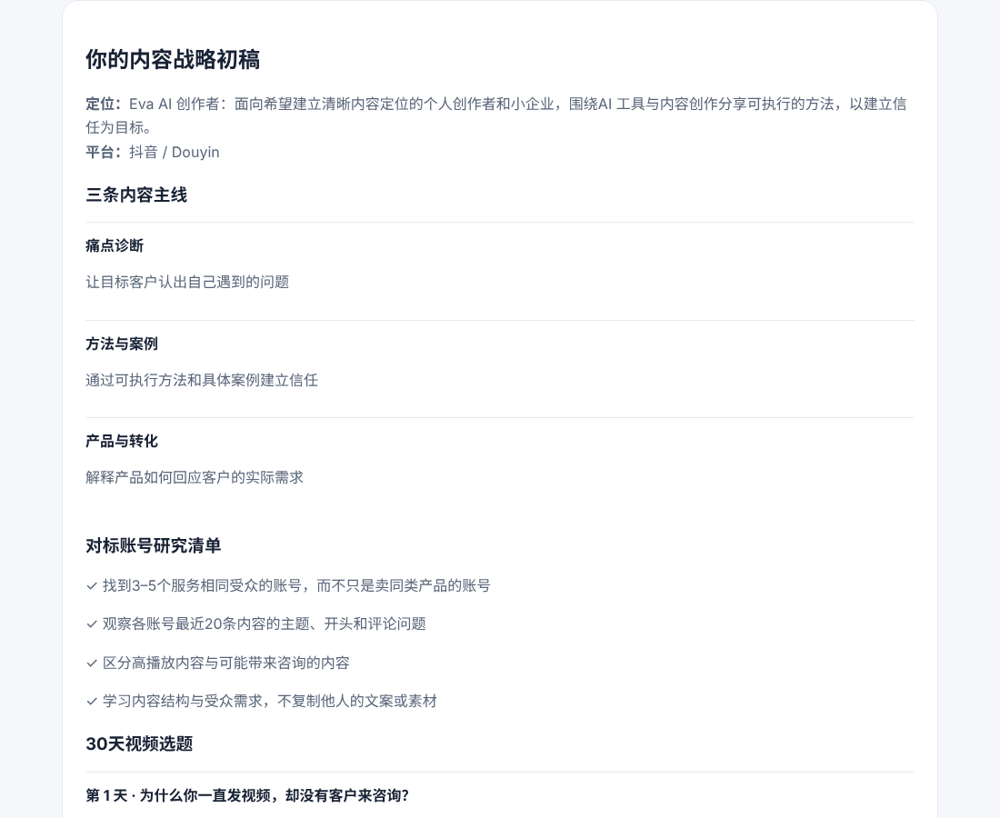

# Eva Content Strategy Engine / Eva 内容战略引擎

[](LICENSE)
**Live demo / 在线体验:** https://rovereva.github.io/Eva-content-strategy/

**English** — An open-source, bilingual (中文 / English) content strategy planner for creators and small businesses. Enter your brand, audience, and offer to get a positioning statement, three content pillars, a competitor-research checklist, and a 30-day video idea plan. It is a single HTML file: no build step, no dependencies, no API key, and no data leaves your browser.

**中文** — 面向个人创作者与小企业的开源双语内容战略工具。填写品牌、目标客户和产品后，即可生成账号定位、三条内容主线、对标账号研究清单和 30 天视频选题。整个项目只有一个 HTML 文件：无需构建、无第三方依赖、无需 API Key，数据不离开浏览器。

| English | 中文 |
|---|---|
|  |  |
|  |  |

---

## Features — implemented today / 当前已实现功能

| Feature | 功能 |
|---|---|
| Full Chinese / English switch: UI, generated report, and JSON export all follow the selected language | 中英文一键切换：界面、生成报告、JSON 导出均跟随所选语言 |
| Brand positioning statement | 账号定位语句 |
| Three content pillars (pain points · how-to & examples · product & conversion) | 三条内容主线（痛点诊断 · 方法与案例 · 产品与转化） |
| Competitor research checklist (manual guidance, not automated scraping) | 对标账号研究清单（人工研究指引，非自动抓取） |
| 30-day plan with 30 unique ideas, each with pillar, angle, sample hook, and CTA | 30 天选题计划，30 条不重复选题，每条含主线、角度、开头示例和行动引导 |
| Export JSON (versioned schema for later Dashboard import) | 导出 JSON（带版本号的数据结构，便于日后导入工作台） |
| Print / Save as PDF (print layout hides the form and buttons) | 打印 / 保存 PDF（打印时自动隐藏表单与按钮） |
| `?lang=zh` / `?lang=en` URL parameter; last choice remembered in the browser | 支持 `?lang=zh` / `?lang=en` 参数；浏览器记住上次选择的语言 |
| Runs 100% locally in the browser; no network requests, no tracking | 完全在本地浏览器运行；无网络请求、无追踪 |

## Planned AI capabilities — NOT implemented yet / 规划中的 AI 能力（尚未实现）

> The current version is a **rule-based template engine**. It does not call any AI model. The items below are roadmap ideas only.
> 当前版本是**规则式模板引擎**，没有调用任何 AI 模型。以下仅为路线图规划。

- [ ] LLM-generated, audience-specific topics and scripts / 大模型按受众生成个性化选题与脚本
- [ ] Live competitor / social-account analysis / 实时竞品与社媒账号分析
- [ ] Performance or virality prediction / 流量与爆款预测
- [ ] Saved projects and user accounts (database) / 项目保存与用户账号（数据库）
- [ ] Reusable module/API for the Creator Dashboard / 供创作者工作台调用的模块或 API

Any future AI feature that needs an API key must keep the key on a server, never in this public repository or in browser code.
未来如接入需要 API Key 的 AI 功能，密钥必须放在服务器端，绝不可写入本公开仓库或前端代码。

---

## Quick start / 快速开始

**Option 1 — open the file / 方式一：直接打开**
Download or clone the repo and double-click `index.html`. / 下载或克隆仓库，双击 `index.html` 即可。

```bash
git clone https://github.com/RoverEva/Eva-content-strategy.git
cd Eva-content-strategy
open index.html        # macOS  (Windows: start index.html, Linux: xdg-open index.html)
```

**Option 2 — local server (optional) / 方式二：本地服务器（可选）**

```bash
python3 -m http.server 8000
# then visit / 然后访问 http://localhost:8000
```

There is nothing to install. / 无需安装任何依赖。

## Usage / 使用方法

1. Choose 中文 or English in the top-right. / 在右上角选择语言。
2. Fill in brand, target audience, and product/service (industry is optional), or click **Load example**. / 填写品牌、目标客户、产品或服务（行业可选），或点击“填入示例”。
3. Pick a business goal and platform, then **Generate strategy**. / 选择商业目标与平台，点击“生成内容战略”。
4. Export JSON or Print / Save PDF. Switching language re-renders the report in that language. / 可导出 JSON 或打印 / 保存 PDF；切换语言会以新语言重新生成报告。

## Deploy to GitHub Pages / 部署到 GitHub Pages

1. Repository **Settings → Pages**. / 打开仓库 **Settings → Pages**。
2. **Source: Deploy from a branch**, **Branch: `main`**, folder **`/ (root)`**, then **Save**. / 选择 **Deploy from a branch**，分支 `main`，目录 `/ (root)`，点 **Save**。
3. After about a minute the site is live at `https://<username>.github.io/<repo>/`. / 约一分钟后即可通过该地址访问。

The repo includes an empty `.nojekyll` file so Pages serves the files as-is. / 仓库已包含 `.nojekyll` 文件，Pages 会原样发布静态文件。

## Project structure / 项目结构

```
.
├── index.html            # the whole app: HTML + CSS + JS, all text in the `dict` object
├── docs/screenshots/     # README images
├── .nojekyll             # serve as plain static files on GitHub Pages
├── LICENSE               # MIT
└── README.md
```

To edit wording or add a language, change the `dict` object in `index.html`. Every language must contain the same keys; `topics` needs 10 entries per pillar.
如需修改文案或增加语言，编辑 `index.html` 中的 `dict` 对象；每种语言的键需一致，`topics` 每条主线需 10 条。

## Creator Dashboard integration / 接入创作者工作台

The engine stays independent so it can be plugged into a dashboard later. / 本项目保持独立，方便后续接入。

- **Now / 现在:** link to the Pages URL, or embed it in an iframe; preset the language with `?lang=en` or `?lang=zh`. / 通过链接或 iframe 嵌入，并用 `?lang=` 参数指定语言。
- **Data hand-off / 数据交接:** the exported JSON has a stable shape: `schemaVersion`, `generatedAt`, `generator`, `language`, `brand`, `industry`, `audience`, `offer`, `goal`, `goalKey`, `platform`, `positioning`, `pillars[]`, `competitorResearch[]`, `ideas[]` (`day`, `pillar`, `title`, `angle`, `hook`, `cta`), `limitations`. / 导出的 JSON 结构固定，可直接被工作台导入。
- **Later / 后续:** extract `dict` + `build()` into a reusable module or API. / 将 `dict` 与 `build()` 抽成独立模块或 API。

## Limitations / 当前限制

This is a rule-based template demo, **not** an AI-powered analysis system. It does not fetch social media profiles, analyze real competitor data, predict virality, or store user data. Ideas come from fixed templates filled with your inputs and need human review before use.
本版是规则式模板演示，**不是** AI 分析系统：未接入大模型、实时竞品数据、流量预测或数据库。选题由固定模板结合你的输入生成，使用前请人工审核。

## Privacy / 隐私

All processing happens in your browser. The page makes no network requests and stores only your language preference in `localStorage`.
所有处理均在浏览器本地完成，页面不发出任何网络请求，仅在 `localStorage` 中保存语言偏好。

## Contributing / 参与贡献

Issues and pull requests are welcome. Please keep the project dependency-free and update both languages together.
欢迎提交 Issue 和 Pull Request。请保持零依赖，并同步更新中英文内容。

## License / 许可证

[MIT](LICENSE) © 2026 Eva Cyber. You may use, modify, and redistribute this project, including commercially, provided the copyright and license notice are kept.
本项目以 [MIT 许可证](LICENSE) 开源。在保留版权与许可声明的前提下，可自由使用、修改、再发布（包括商业用途）。
